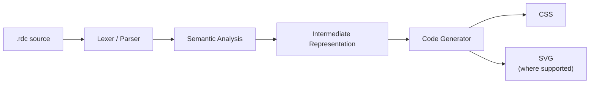
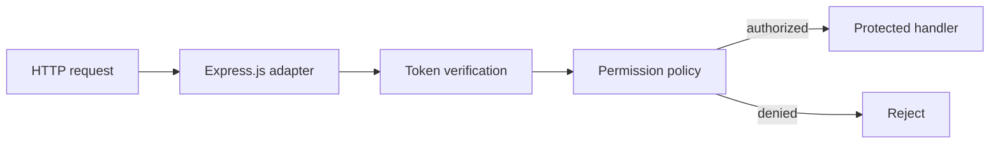

<div align="center">


# RazorDelCSS

### Program your styling. Catch mistakes before the browser does.

A TypeScript-based styling language and compiler that checks your styles, then emits plain CSS.

[](LICENSE)
[](#-development-status)
[](https://www.typescriptlang.org/)
[](#-contributing)
[](https://github.com/NEURAL-Y/RazorDel-Css/issues)
[](https://github.com/NEURAL-Y/RazorDel-Css)

[Quick Start](#-quick-start) · [Language Tour](#-language-tour) · [Validation](#-compile-time-validation) · [Architecture](#-architecture) · [Roadmap](#-roadmap) · [FAQ](#-faq)

</div>

---

> [!WARNING]
> **RazorDelCSS is in early development.** Syntax and APIs will change, and breaking changes are expected. This README describes the project's **design direction**. A feature counts as available only when it is implemented and tested (see the [roadmap](#-roadmap)).

## ✨ Why RazorDelCSS

CSS is powerful, but large projects accumulate repeated declarations, confusing layout interactions and mistakes that are slow to diagnose. RazorDelCSS treats styling as a *language*, not just a file format:

```text
write styling  →  analyze  →  diagnose  →  fix  →  compile  →  browser
```

The browser never needs to understand RazorDelCSS. **The developer does.** The compiler catches supported errors early and emits standard CSS (or other supported output).

### At a glance

<table>
<tr>
<td width="50%" valign="top">

**You write**

```ts
const card = box(height=144px, width=344px);

card.color(
  apply=background,
  color_code="#4f46e5"
);
card.pos_x(189px);
```

</td>
<td width="50%" valign="top">

**The browser gets**

```css
.card {
  height: 144px;
  width: 344px;
  background-color: #4f46e5;
  position: absolute;
  left: 189px;
}
```

</td>
</tr>
</table>

> The example shows the intended authoring style and output. Check the current implementation before relying on any particular syntax.

---

## 🧰 Features

| | Feature | What it's for |
|---|---|---|
| 🧮 | **Programmable styling** | Variables, functions and reusable abstractions instead of repeated declarations. |
| 📦 | **Object-style API** | Describe elements with `box`, `container` and styling methods. |
| 🎨 | **Canvas, dual output** | One drawing definition that targets CSS or standalone SVG where equivalents exist. |
| 📱 | **Responsive layouts** | Write `landscape` / `portrait` rules and get standard media queries. |
| 🔤 | **Font loader** | Font registration, format detection and generated `@font-face` rules. |
| 🔍 | **Compile-time validation** | Catch invalid attributes, target mismatches and context mistakes. |
| 🎬 | **Drawing and animation models** | Dedicated abstractions instead of ad-hoc CSS. |
| 📄 | **Standard output** | Plain, browser-compatible CSS. |
| 🛡️ | **Security-aware analysis** | Planned checks for risky patterns and leaked build metadata. |
| 🔐 | **Secure execution** *(proposed)* | Optional token-gated authorization for protected backend routes via Express.js. |

---

## 🚀 Quick Start

**Requirements:** Node.js 18+ and npm.

```bash
git clone https://github.com/NEURAL-Y/RazorDel-Css.git
cd RazorDel-Css
npm install
npm run compile -- path/to/file.rdc
```

---

## 📖 Language Tour

<details open>
<summary><b>Boxes and containers</b></summary>

<br>

```ts
const card  = box(height=144px, width=344px);
const shell = container(height=600px, width=900px);
```

</details>

<details>
<summary><b>Color and positioning</b></summary>

<br>

```ts
card.color(apply=background, color_code="#4f46e5");
card.pos_x(24px);
```

The analyzer flags unsupported targets, malformed values and context mistakes it can reliably identify.

</details>

<details>
<summary><b>Canvas (CSS and SVG)</b></summary>

<br>

```ts
const stage = canvas(width=400px, height=300px);

stage.color(apply=background, color_code="#0f172a");
stage.shape_selector(circle);
stage.animation(on, delay=200ms);
```

A shared drawing definition can target CSS or SVG when the shapes and operations have meaningful equivalents. Not every CSS feature has an SVG counterpart, so the compiler should **report target mismatches** instead of silently generating misleading output.

</details>

<details>
<summary><b>Responsive layout</b></summary>

<br>

```ts
class CardLayout {
    landscape = { width=344px, height=144px, x=16px, y=8px, z=1 };
    portrait  = { width=300px, height=200px, x=8px,  y=16px, z=1 };
}
```

Supported layout declarations are intended to compile to standard CSS media queries.

</details>

<details>
<summary><b>Fonts</b></summary>

<br>

```ts
const inter = font.load(
    "./fonts/Inter.woff2",
    family="Inter",
    weight=400,
    display=swap
);
```

Generated font rules, path validation and preload hints must be implemented and tested before being treated as available.

</details>

<details>
<summary><b>Variables, functions and classes</b></summary>

<br>

```ts
const primary = "#4f46e5";

function scale(value: number, factor: number) {
    return value * factor;
}
```

The exact accepted syntax depends on the parser and language implementation.

</details>

---

## 🔍 Compile-Time Validation

The analyzer inspects styling instructions *before* any output is generated. These are examples of the intended diagnostics:

<details open>
<summary><b>❌ Invalid attribute</b></summary>

```text
RazorDelCSS Error

Invalid attribute: `line`
`line` is not a supported attribute of `border`.

Location: components/button.rdc:4:9
```

</details>

<details>
<summary><b>⚠️ Missing layout context</b></summary>

```text
RazorDelCSS Warning

`align-items` may have no effect because the parent is not
configured as a flex or grid container.

Location: components/nav.rdc:7:5
```

</details>

<details>
<summary><b>❌ Output-target mismatch</b></summary>

```text
RazorDelCSS Error

`fill` is not supported for this CSS output target.
Use a compatible target or change the declaration.

Location: scenes/stage.rdc:3:14
```

</details>

Actual messages and checks depend on the implemented compiler rules.

---

## 🏗️ Architecture



The optional backend security integration is a **separate** pipeline, so the compiler never needs a server or a network connection:



---

## 🔐 Secure Execution & Express.js Integration

> [!IMPORTANT]
> **This is a proposed design, not an implemented feature.** The `razordel-secure` package below does not exist yet. Do not use it to protect real resources until it has been implemented, reviewed and tested.

### The idea

An optional package for developers who want protected backend operations to run only after a trusted authorization check:

- **Execution policies**: declare which permission an operation requires.
- **Token verification**: validate a credential with a trusted mechanism.
- **Express.js middleware**: authorize before the route handler runs.
- **Default deny**: reject missing, invalid, expired or unverifiable credentials.
- **Separation of concerns**: backend authorization stays independent of CSS generation.

### Illustrative integration

```ts
import express from "express";
// Proposed API. Not implemented yet.
import { secure } from "razordel-secure";

const app = express();

app.get(
    "/premium",
    secure({ permission: "premium:access" }),
    (req, res) => {
        res.json({ message: "Authorized operation completed." });
    }
);

app.listen(3000);
```

`secure()` would return Express middleware that validates the request's credential and permission with a properly configured, trusted verifier. The handler runs only after authorization succeeds.

### Security boundaries

A token check is only as trustworthy as the system that verifies it and enforces the result.

| Do | Don't |
|---|---|
| Keep secrets in server-side config or a secrets manager. | Embed tokens or signing keys in frontend JS, CSS or HTML. |
| Enforce authorization on the server for every protected operation. | Rely on a hidden button or frontend-only check. |
| Verify the caller's permission independently. | Treat an unguessable URL as authorization. |
| Fail closed when verification errors occur. | Run the protected operation when authorization can't be verified. |
| Validate signature, issuer, audience, expiry and permissions. | Invent your own token format. |
| Return only what the caller is authorized to receive. | Commit secrets to the repository. |

### What this does not promise

- It cannot make CSS or HTML secret once they have been delivered to the browser.
- It does not encrypt source code or prevent debugging.
- It does not stop authorized users from copying resources they receive.

### Where it could help

| Use case | Example |
|---|---|
| Protected API routes | Restrict premium endpoints. |
| Administrative operations | Require an explicit admin permission. |
| Private data | Authorize before retrieving protected records. |
| Licensed services | Check a license or entitlement on the trusted backend. |
| Protected resource delivery | Authorize before serving a restricted resource. |

### Proposed phases

1. Define the policy and token-verification interfaces.
2. Implement an independent Express middleware adapter.
3. Test valid, missing, invalid, expired and unverifiable credentials.
4. Add permission checks and route-level integration tests.
5. Document deployment, key management and failure behavior.
6. Consider protected resource delivery only after the authorization layer is reliable.

The security adapter stays an **optional package**. The core compiler does not depend on Express.

---

## 🎯 What RazorDelCSS Is and Isn't

| ✅ It aims to be | ❌ It is not meant to be |
|---|---|
| A TypeScript-based styling language and compiler | A replacement for the browser's rendering engine |
| A programmable styling system with semantic validation | A way to make delivered CSS or HTML secret |
| A foundation for layout, drawing and animation abstractions | A substitute for authentication or secure backend design |
| A place to explore security-aware diagnostics and optional integrations | An Express.js framework built into the core compiler |
| | Production-ready at its current stage |

---

## 🗺️ Roadmap

Items are checked only after implementation and tests.

### Core compiler

- [ ] Core parser and language grammar
- [ ] Semantic analyzer and type system
- [ ] Styling intermediate representation
- [ ] CSS code generator
- [ ] `box` / `container` API
- [ ] Canvas with CSS/SVG output for supported operations
- [ ] Responsive layout abstractions
- [ ] Font loader and generated font rules
- [ ] Functions and reusable abstractions
- [ ] Drawing and animation models
- [ ] Compiler diagnostics and documentation
- [ ] Editor integration and autocomplete
- [ ] Safe compiler optimizations

### Security and backend integration *(proposed)*

- [ ] Threat model and scope for protected operations
- [ ] Execution-policy declarations
- [ ] Token-verifier interfaces with no secrets in client output
- [ ] Optional Express.js middleware adapter
- [ ] Tests for denied and authorized requests
- [ ] Permission-level authorization with default-deny behavior
- [ ] Server-side secret handling and deployment docs
- [ ] Controlled delivery of protected resources

---

## 🚧 Development Status

RazorDelCSS is early-stage. Syntax, compiler architecture, APIs and tooling may change. The secure-execution and Express.js integration are **proposals**, not implemented or production-ready functionality.

---

## ❓ FAQ

<details>
<summary><b>Does RazorDelCSS run in the browser?</b></summary>

No. The compiler emits standard CSS, so the browser never executes the language itself.

</details>

<details>
<summary><b>Does the security extension hide CSS from developer tools?</b></summary>

No. CSS delivered to a browser can generally be inspected. The extension focuses on server-side authorization for protected operations and on resources the server has not yet released.

</details>

<details>
<summary><b>Does the Express.js integration belong in the core compiler?</b></summary>

No. It is better as an optional adapter or separate package so the compiler stays independent of backend frameworks.

</details>

<details>
<summary><b>Can I use the output with existing CSS?</b></summary>

That is the goal: standard CSS that fits existing frontend build pipelines. Compatibility depends on which compiler features are implemented.

</details>

<details>
<summary><b>Is the security feature ready for production?</b></summary>

No. It needs implementation, testing and security review first.

</details>

---

## 🤝 Contributing

Contributions are welcome.

1. Fork the repository and create a focused branch.
2. Open an issue before making a major language or architecture change.
3. Include tests for compiler behavior, diagnostics and security-sensitive logic.
4. Document limitations and expected behavior.
5. Open a pull request that explains the problem and your solution.

For security-sensitive issues, never publish real credentials, tokens, private keys or exploitable details in public reports.

## 📜 License

Released under the [Apache License 2.0](LICENSE).

---

<div align="center">

**Program your styling. Catch mistakes early. Keep authorization on the trusted side.**

⭐ [Star the repository](https://github.com/NEURAL-Y/RazorDel-Css) to follow development.

</div>
